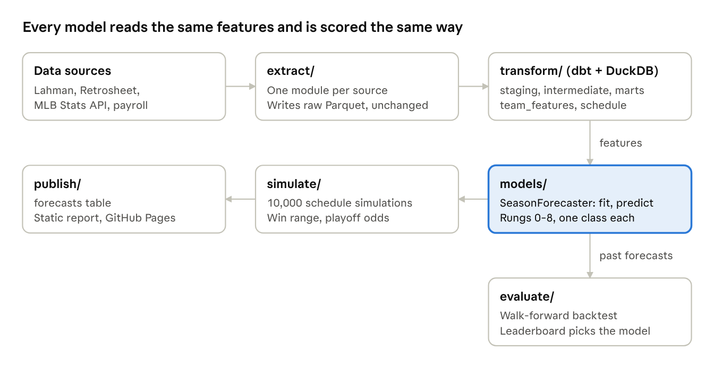
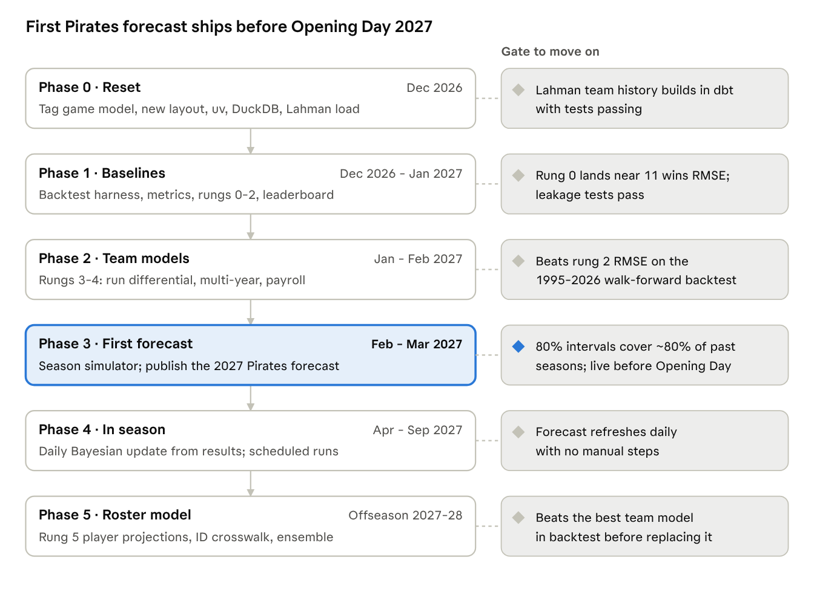

# Bucco Forecasting: Season Win Model Plan

Nov 21, 2026 · @Chris

Bucco Forecasting pivots from predicting single Pirates games to forecasting the Pirates' full regular-season record, starting with the 2027 season. The model is a ladder: a naive baseline first, then increasingly sophisticated models that each must beat the one below it on a shared, league-wide backtest before they replace it.

The output is a range, not a point: "78 wins, 80% interval 69–87, 14% playoff odds" is the target shape of every forecast this project publishes.

## Goals

The primary goal is a calibrated preseason forecast of Pirates wins, updated through the offseason as rosters change and locked on Opening Day. In-season updating is a later, separate phase that builds on this preseason model (Bayesian updating, with the preseason forecast as the prior).

### Objectives

1. **Forecast:** Publish a preseason win distribution, division finish odds and playoff odds for the Pirates each season.
2. **Measure honestly:** Score every model on all 30 teams across many past seasons, never on Pittsburgh alone. One team gives about 25 usable seasons, which is too few to tell models apart.
3. **Stay modular:** Every model plugs into the same interface, so a new model is a new class plus a leaderboard row, not a pipeline rewrite.
4. **Learn:** Each rung of the ladder should teach one idea (combining forecasts, WAR-to-wins, aging, roster construction).
5. **Update in season:** Later phase, developed separately: blend the preseason forecast with games played so the range tightens as the season goes on.
6. **Develop Data Infrastructure**: Build out capacity to acquire and store relevant data for all elements of the project (i.e. preseason forecast, in season updates, individual performance modeling)

### Success metrics

Random variation alone puts a floor of about 6.4 wins (one standard deviation) under any model, so the realistic range for improvement is narrow. Figures below are approximate, from memory, to be confirmed by our own backtest.

| Benchmark | Approx. RMSE (wins) | Role |
| --- | --- | --- |
| Every team wins 81 | \~11 | Floor to beat |
| Last year's wins, regressed to the mean | \~9 | First real baseline |
| Public projection systems | \~7–8 | Stretch target |
| Pure luck (binomial over 162 games) | \~6.4 | Theoretical limit |

- **Point accuracy:** RMSE and MAE of projected vs. actual wins, all teams, walk-forward.
- **Calibration:** About 80% of actual win totals land inside the 80% intervals.
- **Distribution quality:** CRPS (a score that rewards both accuracy and honest uncertainty) for comparing models that output ranges.
- **Market check (optional):** Compare against preseason sportsbook win totals, which are a strong public benchmark.

### Non-goals

- Predicting individual games for betting or daily picks. The game model is archived in legacy/; useful parts may be reused later.
- Beating professional projection systems. Getting close with a transparent, reproducible model is the goal.
- Postseason series outcomes, beyond playoff odds as a by-product of the simulation.

## Methods

Every model predicts all 30 teams for a target season using only information available before that season, and returns a mean and a spread. Models climb a ladder; a rung earns its place only by beating the rung below it in the backtest.

### Model ladder and project phases

| Phase | Model | Core idea | Teaches |
| --- | --- | --- | --- |
| 0 | Constant | Every team wins 81 | The floor |
| 1 | Persistence | Same record as last season | Why raw records overreact |
| 2 | Stacked projections model | Collect public preseason win projections from reputable forecasters and fit a stacked model that weights them, including sportsbook preseason win totals where historical data are available | Combining expert forecasts |
| 3 | FanGraphs WAR forecast | Translate FanGraphs preseason team WAR projections into wins and losses (wins ≈ replacement level + team WAR) | WAR-to-wins conversion |
| 4a | Roster-based (a): public projections | Take each player's projection from reputable public systems (e.g. ZiPS, Steamer, PECOTA), scored per source, multiply by projected playing time, sum WAR; wins ≈ replacement level + total WAR | Bottom-up forecasting |
| 4b | Roster-based (b): our own projections | Project each player ourselves (weighted 3-year history, regression, age curve), multiply by projected playing time, sum WAR; wins ≈ replacement level + total WAR | Player projection: aging, regression |
| 5 | Schedule simulation | Team strengths → game win probability (log5 plus home field) → simulate the real 162-game schedule 10,000+ times | Distributions, playoff odds |
| 6 | In-season Bayesian update (later phase) | Preseason forecast is the prior; games played are the evidence | Updating beliefs |
| 7 | Ensemble (optional) | Weighted blend of the best rungs, optionally with market win totals | Combining forecasts |
| 8 | Season Simulator | Develop capacity to simulate impact of roster moves, injuries, individual performance on predicted season win total | Counterfactuals and sensitivity analysis (comparative statics) |

Rungs 0–1 need only historical team records; rungs 2, 3 and 4a need archived public forecasts. Rung 4b is the largest data and modeling effort, so it starts only after rungs 0–4a are on the leaderboard.

### Common interface

Every model implements the same two methods, so the backtest, simulator and publisher never need to know which model they are running.

```python
class SeasonForecaster(Protocol):
    name: str

    def fit(self, history: pd.DataFrame) -> None:
        """history holds only seasons before the target season."""

    def predict(self, season: int, as_of: date, features: pd.DataFrame) -> pd.DataFrame:
        """Returns one row per team: team_id, mean_win_pct, sd_win_pct."""
```

- Predict win percentage, not wins. This handles the 60-game 2020 season and any future shortened season; convert to wins (× 162) only for display.
- `as_of` makes the forecast date explicit, so the same model can produce a preseason forecast or a mid-season one.
- A model that has no natural spread (rungs 0–4b) gets one from its backtest residuals.

### Backtest

- **Walk-forward by season:** for each target season (2001–2026, using 2000 as the first prior season), fit on earlier seasons only, predict all teams, store results.
- **Results table:** one row per model, season and team, with predicted mean, spread and actual. The leaderboard is a query on this table.
- **Pirates view:** a report of Pirates-only errors for interest, never used to choose models.
- **Hyperparameters** (like the stacking weights in rung 2, or the age curve in rung 4b) are tuned inside each walk-forward step, never on the full history.

### Uncertainty

The range comes from two sources, and both must be in the published interval:

1. **Talent uncertainty:** we don't know exactly how good the team is. This shrinks as the model improves.
2. **Game-to-game luck:** even a team with known talent varies by about ±6.4 wins over 162 games. This never shrinks.

Rung 5 handles both naturally: draw a talent level for each team, then simulate the schedule.

## Data

The core dataset is one row per team per season, and historical team records are enough for rungs 0–1. Public forecasts feed rungs 2–4a, and player-level data comes in at rung 4.

### Units of analysis

| Table | Grain | Needed from |
| --- | --- | --- |
| `team_seasons` | team × season | Rung 0 |
| `external_forecasts` | source × team × season × publish date (forecasters, sportsbook win totals) | Rung 2 |
| `team_war_projections` | team × season × as-of date (FanGraphs preseason WAR) | Rung 3 |
| `player_projections` | source × player × season × as-of date (ZiPS, Steamer, PECOTA) | Rung 4a |
| `player_seasons` | player × season × team | Rung 4b |
| `rosters` | player × team × as-of date (projected playing time) | Rung 4a |
| `schedule` | game | Rung 5 |
| `games_played` | game, with result | Rung 6 |
| `scenarios` | scenario × player × team (roster move, injury, performance change) | Rung 8 |
| `forecasts` / `backtest_results` | model × season × team × as-of date | Rung 0 |

### Sources

| Source | What it provides | Used by | Notes |
| --- | --- | --- | --- |
| Lahman Baseball Database | Team W–L, runs for and against, player batting/pitching/fielding, 1871 to last season | Rungs 0–1, 4b | Free CSVs, updated once a year after the season. The backbone for history. |
| Retrosheet | Game logs and historical schedules | Rungs 5–6 backtests | Free; requires an attribution notice. |
| MLB Stats API | Current schedule, standings, rosters, transactions, injured list, live results | Rungs 4a–6 and 8, production | Free and undocumented; already used in this repo. |
| Public forecasts (e.g. FanGraphs Depth Charts, ZiPS, Steamer, PECOTA) | Preseason team win projections (rung 2), FanGraphs team WAR (rung 3), player projections by source (rung 4a) | Rungs 2, 3, 4a | Backtests need archived preseason editions; check each site's terms. |
| Baseball-Reference WAR (via `pybaseball`) | Player WAR by season | Rung 4b | Check terms of use and availability before depending on it. |
| Chadwick Bureau register | Player ID crosswalk across Lahman, Retrosheet, MLB, FanGraphs, B-Ref | Rungs 4a–4b | Free; essential for joining player sources. |
| Preseason win totals (sportsbooks) | Market expectation per team | Benchmark, rungs 2 and 7 | Historical archives are scattered; rung 2 includes them only if a usable archive is found. |

### Rules for using only past data

- A forecast for season *t* as of date *d* may use only data that existed on *d*. The backtest enforces this by filtering on dates, not by convention.
- Preseason rosters use Opening Day rosters, not end-of-season rosters, which include in-season trades the model couldn't have known.
- Payroll uses the opening-day figure for season *t*, not the end-of-season figure.
- Player stats for season *t* never appear in features for season *t*.

### Known quirks

- **Shortened seasons:** 2020 (60 games), 1994–95 and 1981 (strikes). Model win percentage; consider down-weighting 2020 as a predictor.
- **Changes in scoring:** run environments shift (the 2023 pitch clock, ball changes). Normalize runs to the league average for each season.
- **Rule and schedule changes:** universal DH (2022) and the balanced schedule (2023) change what a team's schedule looks like.
- **Franchise continuity:** relocations and renames (e.g. Expos to Nationals) need a stable franchise ID; expansion teams (1993, 1998) have no prior season.
- **History window:** use seasons from 2000 onward for now, both to fit and to score the leaderboard; extend back later only if more history clearly helps.

## Tech stack

The data is small (about 3,000 team-seasons and roughly 100,000 player-seasons), so the stack should be local, file-based and cheap to run. The recommendation is DuckDB with dbt for data, plain Python for models, and an orchestrator added only when daily in-season updates need one.&#32;

| Layer | Recommendation | Why | Alternative |
| --- | --- | --- | --- |
| Storage | DuckDB file + Parquet for raw extracts | No server to run, fast analytics, easy to version or rebuild | Postgres in Docker: archived in legacy/ for a return of daily game predictions |
| Transforms | dbt with `dbt-duckdb` | Keeps SQL models, tests and docs; existing dbt skills carry over | SQL files run from Python |
| Extraction | Python modules, one per source, writing Parquet | Raw data is kept unchanged and can be re-transformed anytime | Direct writes to the database |
| Modeling | pandas or polars, NumPy, scikit-learn, statsmodels | Rungs 0–4 are lookups, sums and simple regressions; no need for gradient boosting on \~30 rows a season | XGBoost later, if a rung clearly earns it |
| Bayesian / simulation | NumPy for simulation; conjugate updates or PyMC for rung 6 | Vectorized simulation of 10,000 seasons runs in seconds | Stan |
| Experiment tracking | `backtest_results` table + a leaderboard query | Enough for a solo project; nothing extra to host | MLflow |
| Orchestration | A command-line tool (`bucco extract`, `bucco backtest`, `bucco forecast`) first; Dagster once rung 6 needs a daily schedule | Preseason forecasting runs a few times a year; daily scheduling only matters in season | GitHub Actions on a schedule |
| Environment | `uv` + `pyproject.toml` | One lockfile, fast installs; replaces the current mix of Pipfile and requirements.txt | Poetry |
| Quality | `pytest`, `ruff`, pre-commit | Tests that check no future data leaks into a forecast are the most valuable tests in this project | — |
| Publishing | Quarto blog on GitHub Pages (longer term): a post per forecast update, with what changed | Free, versioned, shareable | Streamlit app |
| Configuration | YAML model registry validated with Pydantic | Adding a model = adding a class and a config entry | Hard-coded lists |

### Source data: document the fetch, keep only what can't be fetched again

Where a source can be retrieved again on demand, the project keeps a written recipe for getting it, not a copy. Storing less is never less permissible than storing more, and it usually sits better with sites' terms. The exception is data that changes or disappears: a forecast made from it can't be reproduced unless that snapshot is kept.

| Data | Policy | Why |
| --- | --- | --- |
| Lahman, Retrosheet, Chadwick | Fetch from a pinned release; local cache, rebuildable | Versioned downloads that can be fetched again |
| MLB Stats API (history, schedules) | Fetch on demand; local cache, rebuildable | Past seasons don't change |
| Public forecasts, sportsbook win totals, Opening Day rosters | Snapshot and keep | They change daily and old editions can't be fetched again |
| Our own forecasts and backtest results | Keep | They are the project's output |

Each source gets an entry in a `config/sources.yml` manifest:

- **What:** endpoint or download URL, parameters, the fetcher module that calls it, and the tables it feeds.
- **Pin:** release or version, retrieval date, row count and a checksum of the result, so a re-fetch can be checked against the original.
- **Terms:** a link to the terms of use, the attribution required, and any rate limit.
- **Retention:** `cache` (safe to delete and rebuild) or `snapshot` (must be kept).

Cached files live in a gitignored `data/cache/` folder and can be deleted at any time. A `bucco extract --source <name>` call rebuilds them, and a test fails if the checksum no longer matches. Snapshots live in `data/snapshots/`, the only raw data that needs a backup.

## Project structure

The code splits into six modules with one-way dependencies; models are the only part that changes often, and they never touch the database directly.



Data flows left to right across the top, then models produce team strengths that the simulator turns into published ranges; the backtest decides which model runs.

### Module boundaries

- **extract/** only downloads and saves raw data. No cleaning, no joins.
- **transform/** owns all cleaning and joins, in SQL with dbt tests.
- **models/** takes DataFrames in and returns DataFrames out. No file or database access, so every model is easy to test.
- **evaluate/** is the only module that sees a target season's actual results.
- **simulate/** depends on the model interface, never on a specific model.
- **notebooks/** is for exploration; nothing imports from it.

### Folder layout

```text
bucco_forecasting/
├── pyproject.toml
├── config/models.yml        # model registry
├── src/bucco/
│   ├── extract/             # lahman.py, retrosheet.py, mlb_api.py, payroll.py
│   ├── transform/           # dbt project: staging, intermediate, marts
│   ├── models/              # base.py, naive.py, stacked.py, fangraphs_war.py, roster.py
│   ├── simulate/            # season.py, in_season_update.py
│   ├── evaluate/            # backtest.py, metrics.py, leaderboard.py
│   ├── publish/             # report generation
│   └── cli.py
├── data/                    # raw Parquet + bucco.duckdb (gitignored)
├── notebooks/
├── tests/                   # including data-leakage tests
└── legacy/                  # game-level model + its Postgres/Docker/Dagster stack, archived with a README on restoring it
```

## Roadmap

The plan puts a simulated 2027 Pirates forecast online before Opening Day, built on team-level models; the roster model waits for the 2027–28 offseason.



Each phase ends with a gate it must pass before the next starts; dates are proposals for a hobby pace, not commitments.

## Risks and open questions

The biggest risk is mistaking noise for progress: with a 6.4-win luck floor, a model that looks 0.3 wins better may not be better at all.

| Risk | Effect | Mitigation |
| --- | --- | --- |
| Noise mistaken for improvement | A worse model gets promoted | Compare models season by season (paired), with bootstrap intervals on the RMSE gap |
| Future data leaking into forecasts | Backtest looks better than real forecasts will | Filter by as-of date in the backtest; automated leakage tests; Opening Day rosters only |
| Overfitting the stack | Rung 2 wins the backtest by chance | Few sources, non-negative weights, tuning inside each walk-forward step |
| Fragile sources | Undocumented API changes or blocked scraping break the pipeline | Document each fetch in the source manifest; snapshot only data that can't be fetched again; check each site's terms; prefer Lahman and Retrosheet |
| Scope creep at rung 4b | Player projections stall the project | Rung 4b starts only after a forecast is live (Phase 5) |
| Hometown bias | Choices tuned to make the Pirates look good or bad | Pick models on league-wide results only |

### Open questions

- [x] Forecast dates: Opening Day only, or also a mid-offseason forecast (e.g. Feb 1) after major moves?

  Decided: the forecast can be re-run any time before Opening Day, after trades, signings and injury news. It locks on Opening Day, and that locked version is the forecast of record. Backtests score the forecast as of Opening Day; earlier versions are stored by as-of date.
- [x] Outputs at launch: wins only, or division finish and playoff odds from the first forecast?

  Decided: all three from the first forecast: win distribution, division finish and playoff odds. That means the schedule simulation (rung 5) must be ready for launch.
- [x] Stack: move to DuckDB and a command-line tool, or keep Postgres, Docker and Dagster?

  Decided: move to DuckDB and the command-line tool. The Postgres, Docker and Dagster setup is archived in `legacy/` with notes on how to bring it back, in case daily game predictions return.
- [x] Market benchmark: is it worth tracking down historical sportsbook win totals?

  Decided: yes, if a usable archive turns up without much effort. Give the search a short timebox. If nothing usable turns up, drop sportsbooks from the rung 2 backtest, and start snapshotting win totals each preseason from 2027 onward.
- [x] History window: fit on 1961 onward, or only 1995 onward?

  Decided: 2000 onward for now, for both fitting and scoring.
- [x] Game-level model: archive it in `legacy/`, or reuse it as the game win-probability step inside the simulator?

  Decided: archive it in `legacy/` for now. The simulator starts with log5; useful parts of the game model are pulled in later when they earn it.
- [x] Publishing: a public static page, or a private table and notebook?

  Decided: public, as a blog in the longer term. Each post gives the updated forecast and summarises what changed since the last one, such as roster moves or model changes. The cadence is still open. Until then, the forecast table and notebook stay private.
